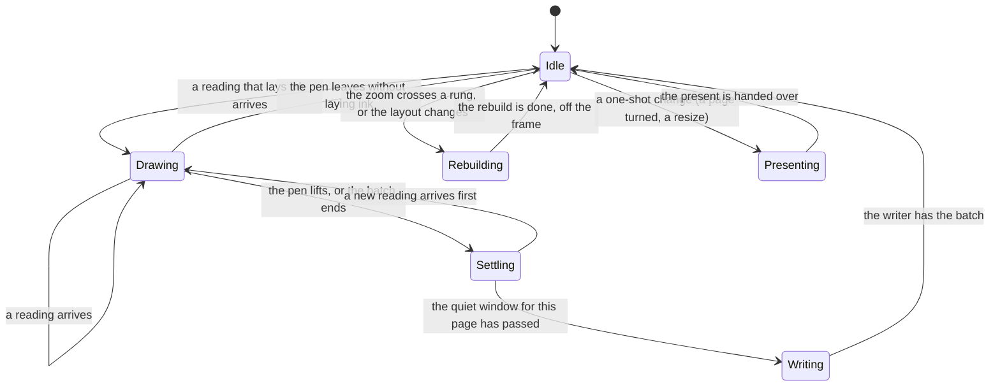

# The engine contract: 120 fps and low power, at the same time

This is the contract for **`cheap-note-engine`** — the ink renderer this application would have if
its only requirements were *120 frames a second on the frame in front of the pen, and nothing spent
when nothing is happening*. It is a design document, not a description of shipped code: nothing in
this repository implements it yet, and the crate does not exist (yet — §2 is where it starts).

It is written to sit beside [ARCHITECTURE.md](ARCHITECTURE.md) (what runs where *today*),
[VIEW.md](VIEW.md) (why the view is arranged as it is, and every measurement that shaped it) and
[WINDOWS.md](WINDOWS.md) (where the platform underneath changes the answer). Where this document
contradicts one of those, **this one is the ideal and they are the present**; where it contradicts a
measurement, **the measurement wins**.

`ENGINE.md` (the working note at the repository root: six layers, wgpu, vger) is the *input* to this
document. This file keeps what survives contact with the platform, the budget and the arithmetic,
and says plainly what does not.

If you read only one paragraph, read this one:

> **A still canvas costs nothing, a stroke costs its own pixels once, and the frame the reader sees is
> composited the way the system already composites.** The engine is a tiered one — a cached base layer
> the size of the sheet, an ink layer that is appended to only while a stroke is open, a ghost layer in
> the system's overlay plane — and each tier has a budget in microseconds rather than a shape in
> triangles. Ink is drawn once, as the union of the nib's discs, and *repaired* by repainting only the
> band a new reading swept — never the page; movement of what is already drawn is a uniform, never a
> rebuild. There is no `wgpu`, there is no arena of geometry, and there is no timer that redraws.

## 1. What the engine promises

Six promises. Each is a *behaviour* with a number attached, and each number is the default a reviewer
should hold the implementation to. The rest of this document is the argument for why they can all hold
at once.

| # | Promise | The number | How it is shown (§7) |
|---|---|---|---|
| E1 | **A still canvas draws nothing.** No present, no GPU work, no CPU wake, while nothing changes. | 0 presents/s · 0 wakes/s · < 0.5 % of one core | `stills_cost_nothing` |
| E2 | **An open stroke costs its own band, once.** One reading appends the band it swept; nothing is rebuilt. | ≤ 250 µs CPU · ≤ 1.0 ms measure (8 K strokes on the page) | `a_reading_costs_its_band` |
| E3 | **The ink reaches the glass within 1.5 refresh intervals.** Handed over immediately, never waiting for the compositor. | hand-off ≤ 1.0 ms at p99; ≤ 1 frame of extra latency | `hand_off_never_waits` |
| E4 | **Ink reaches the disk inside a bounded window.** The window closes early when the page settles. | ≤ 250 ms after movement stops; ≤ 500 ms hard cap | `a_pause_is_written_before_it_is_felt` |
| E5 | **Power is proportional to change.** Idle is the cheapest state; a page turn is paid once; a zoom never re-draws the ink. | page turn ≤ 1 refresh interval of GPU; zoom = 1 uniform | `a_page_turn_is_paid_once`, `a_zoom_is_a_uniform` |
| E6 | **No pixel is shaded twice for one reading, and ink is never the wrong colour.** The union, not the overlap. | 0 double-composited pixels on the ink's own layer | `a_band_is_composited_once` |

### What the engine is *not*

* **It is not a UI toolkit.** The bar, the pills, the lists and the text stay where they are — GPUI,
  once a frame, only when something about them changed. The engine draws **the canvas**: desk, sheet,
  shadow, ruling, the document's page, the ink, the ghost. That is the whole of its surface.
* **It is not a scene graph.** The engine is handed *events* (a reading arrived, a page was turned, the
  zoom changed, a selection moved) and a *description* (§3), never a tree.
* **It does not own the paper.** Page size, ruling, colours, pen widths, the page list and every
  setting belong to the note ([STORE.md](STORE.md) §3). The engine receives a resolved description.
* **It is not a compositor.** It does not decide when a window is shown; it decides when *it* needs to
  be redrawn, and the compositor decides what reaches the glass. That division is the reason E1 is
  possible at all — see §2.4.

### The one rule everything else follows

> **The cost of a frame is the area that changed, times the work per pixel, and nothing in the engine
> may be proportional to what did not change.**

Everything in this document is a way of keeping one of those three factors at zero. The present count
is zero because the *area* is zero. A pan is cheap because its *work per pixel* is a transform. A zoom
is cheap for the same reason. The band is cheap because it is the *only* area a reading changes. The
journal exists because the area that changed has to survive a crash. And the one thing that is
proportional to the page — the layer the sheet lives on — is paid once per page and then only moved.


## 2. The ground the engine stands on

This section exists because two of the input note's central premises cannot serve this application,
and the alternative they imply is *worse* than the arrangement the code already has. Both facts were
checked rather than assumed.

### 2.1 `wgpu` cannot be this window's canvas, because it cannot see this window

The whole of the current arrangement rests on one platform fact ([ARCHITECTURE.md](ARCHITECTURE.md)
§2): the interface is GPUI's DirectComposition target (topmost), and the canvas is a **second**
DirectComposition target on the same `HWND` with `topmost = false`, drawn behind it. Microsoft
documents at most two targets per window, one topmost and one not
([`CreateTargetForHwnd`](https://learn.microsoft.com/en-us/windows/win32/api/dcomp/nf-dcomp-idcompositiondevice-createtargetforhwnd)),
which is why `apps/windows/src/platform/ink_layer/device.rs` exists and why [WINDOWS.md](WINDOWS.md)
§3.5 records what happened when a GPUI release took both.

`wgpu`'s window surface is a swap chain for *its own* window or *its own* composition visual; it has
no seat at a target GPUI already owns. An engine on `wgpu` would therefore have to own the window, and
the interface would have to be an engine layer too — a rewrite of the toolkit, not of the canvas.

**The engine is written twice behind one seam**, and that is the correct amount of work:

| Half | Device and presentation | What it must not do |
|---|---|---|
| `cheap-note-engine-d2d` | Direct3D 11 device, a Direct2D 1.1 context bound to the canvas's swap chain, composed through the non-topmost target it already has | allocate per reading; flush per frame ([WINDOWS.md](WINDOWS.md) §5: removing that flush cut present/frame by 20–27 %) |
| `cheap-note-engine-metal` | `MTLDevice`, `CAMetalLayer` as the app's own layer under GPUI's view | animate `frame`/`contents` ([MACOS.md](MACOS.md) §4.3); present with nothing to show |

The portable half (`cheap-note-engine`) owns every number in §5. Both platform halves are *cursors*
over the geometry it returns: a band is a list of trapezoids and fans (Direct2D: one
`ID2D1GeometryRealization` over them; Metal: one triangle list), and a page is one textured rectangle
(Direct2D: `DrawBitmap` through a transform; Metal: one quad with the page's texture).

A third half is not forbidden — `wgpu` would be the honest choice on a platform whose window the app
owns outright — but the contract only ever requires the two that can be a peer of GPUI in this window.

### 2.2 Analytic strokes — vger, or a fragment shader — are the wrong trade here

`vger` is a real and good renderer (wgpu-based, curves stroked analytically in the fragment shader).
Its argument is sound *for a renderer that owns the window and lives on a device whose budget is
fragment-bound*. It is not sound for this canvas, for three reasons that are arithmetic rather than
taste:

1. **The strokes are not curves; they are readings.** A stroke here is the union of the discs the nib
   left — a whole `Model` ([VIEW.md](VIEW.md) §7, *The highlighter*) — and the app's scroll, zoom and
   culling are all expressed over that union's pieces. A curve fit would be recomputed on every zoom
   and would carry a fidelity question the union does not have (a fit of 200 readings is not the
   readings).
2. **The cost is in fragments, not vertices.** [VIEW.md](VIEW.md) §11 measured it: a page at 356 K
   vertices is under a fifth of a millisecond of vertex work, while the fragments are over 30 M
   samples against under a million vertices. Analytic strokes move work *into* the fragment stage at
   exactly the bezier's area — where this app is already poor — to save vertex work it is not short
   of. The measurement that killed the raised `FACET` is the same measurement that kills this.
3. **It duplicates work at the only place the engine re-draws.** The engine draws a band *once* per
   reading and then never touches those pixels until something covers them. A fragment-shader stroke
   re-shaded on every present is re-shading a curve whose pixels have not changed — which is exactly
   what E1 forbids.

What replaces it keeps the *goal* — never tessellate a curve on the CPU per frame — without the cost:
the band is tessellated **once, at the fidelity of the current zoom**, appended to a layer, and then
free. The same insight as `vger`'s "pixel cost only", moved one level up: **pixel cost once per
change, not once per frame.**

### 2.3 The rest of the input note's list, item by item

The input note is a good survey of techniques; four of its six layers survive the platform unchanged,
one survives in a different form, and one is the thing the engine deliberately does without.

| Input layer | Verdict | Why |
|---|---|---|
| **1 · Input pipeline** — coalesced events, idle detection, a latest-only queue | **kept, and already true** | the pen hands over a *batch* through an `Arc` inbox and the pump waits on it rather than polling ([ARCHITECTURE.md](ARCHITECTURE.md) §3); idle is the absence of a batch, and §4.3 turns it into the cheapest state rather than a mode |
| **2 · Stroke store** — arena, SoA, finished strokes compressed | **kept in spirit, refused in form** | SoA is right where the *page* lives (it is the format: [STORE.md](STORE.md) §4), and the stroke list is already `Arc<Vec<Arc<Stroke>>>` with derived geometry skipped from serde ([VIEW.md](VIEW.md) §10). An arena of *geometry* is not: every pixel of a finished stroke lives on a GPU layer (§4.1), and geometry for it would be 172 KB a stroke against 2.4 KB of points ([VIEW.md](VIEW.md) §10) — while `bumpalo`'s `Bump` runs no destructors, which is the one thing a handle to a GPU resource must have |
| **3 · Spatial index** — quadtree / spatial hash, `O(log S + k)` | **kept, and already enough** | the page's strokes are culled by `visible_in` against a precomputed box at **6.3 µs for 8,182 strokes** — 3,800× cheaper than a rebuild ([VIEW.md](VIEW.md) §11). A tree over a flat pass would save microseconds and cost an index to keep in step with every edit; the engine keeps the flat pass and says so (§5.3) |
| **4 · LOD** — Douglas–Peucker, power-of-two scale buckets | **replaced** | DP simplifies a *polyline*; a stroke is a union of discs, and what changes with zoom is how finely its *arcs* are cut, not how many readings it keeps. The engine's LOD is the same idea at the right granularity: a `DETAIL_FACTOR` step, paid off the frame ([VIEW.md](VIEW.md) §11). A power-of-two bucket that *dropped readings* would make a handwritten line change shape as it was zoomed — the one thing a page of writing must not do |
| **5 · Render orchestration** — damage rects, scissor, analytic strokes | **kept, restated** | batch damage to the *open stroke's band*, and the tiered composition of §4. Analytic strokes are refused (§2.2) |
| **6 · Frame pacing and power** | **kept, and sharpened** | the presenter is the compositor's, so pacing is the engine's *own* decision to draw (§4.3), and the app's two settings (`frame_cap`, `vsync`) become two answers with a defined interaction (§6) |

### 2.4 The four assumptions, named

The engine's numbers are only as good as these, and each can be falsified on a machine:

1. **The compositor presents only what it is given.** A target with no new frame is not presented
   again — which is what makes 0 presents/s an idle state rather than only a CPU saving.
2. **A canvas layer can be a persistent surface.** The ink's layer is not cleared and reloaded per
   frame; it is written into and left. Direct2D's full-scene colour cache on Windows and a
   `CAMetalLayer` with `framebufferOnly = false` on macOS both give this.
3. **The window's rect is composited back to front in the order the targets are given** — already the
   fact the whole arrangement rests on ([ARCHITECTURE.md](ARCHITECTURE.md) §2).
4. **A pointer update can be shown without the app's frame.** The ghost is in a layered window above
   everything on Windows, and on the Mac in the canvas pass, so a reading that lays no ink is visible
   without touching the interface.


## 3. The shape: three tiers, two layers of content, one state

### 3.1 The tiers, back to front

```
 ┌──────────────────────────────────────────────────────────────┐  above everything
 │  T2 · ghost          a layered window / an overlay plane     │  written per reading,
 │                      the nib, the rod, its shadow            │  never composited with the ink
 ├──────────────────────────────────────────────────────────────┤
 │  T1 · interface      GPUI's own target, topmost              │  a frame only when the
 │                      the bar, pills, lists, dialogs, text    │  interface changed
 ├──────────────────────────────────────────────────────────────┤
 │  T0 · canvas         the engine's target, topmost = false    │  M  base layer  (the sheet)
 │                      the desk, sheet, shadow, ruling, page,  │     I  ink layer  (finished ink
 │                      ink, selection, lasso, and nothing else │        + the open band)
 └──────────────────────────────────────────────────────────────┘  behind everything
```

T0 is the engine's whole painting surface, and it has far fewer moving parts than it looks:

| Part of T0 | Changes when | Paid |
|---|---|---|
| desk | the theme's desk colour changes | once |
| sheet + shadow | a page is turned, a size or colour changes, the layout changes | once per layout |
| ruling | same | once per layout |
| page bitmap | a PDF page is turned to, the grayscale switch, a rotation, `Lean` | once per page (the rasteriser's job, [VIEW.md](VIEW.md) §8) |
| **finished ink** | a stroke is closed, erased, moved, undone, redone | the *band* that changed |
| **open band** | every reading while the pen is down | the band that reading swept |
| selection, lasso | the lasso is swept, held, dragged | the ink layer is re-tinted, never re-tessellated |

### 3.2 Why two layers *inside* T0 rather than one surface

A surface that is written into and left (a swap chain on Windows, a `CAMetalLayer` on the Mac) has to
answer one question per present: *what do I show, and what do I keep?* Two layers answer it once for
each kind of content, and the split is the whole of why the ink can be repaired rather than rebuilt:

| Layer | Contents | Kept? | Written how |
|---|---|---|---|
| **M — the base** | desk, shadow, sheet, ruling, page, the page furniture | across presents and pans, until the layout changes | composited once per layout; then its *texture* is transformed |
| **I — the ink** | the page's finished ink, the open band, the selection's tint, the lasso's ring | across readings, zooms and pans, until the page changes | appended per band; **repaired** where an edit or a new reading uncovered pixels (§4.2) |

The two are composited back to front into the target on every present (M, then I). That is one
full-screen pass per present, and it is a *composite*, not a redraw: nothing in it runs the ink's
geometry, and nothing in it touches the page's text.

The alternative — one layer holding everything — is what the current Windows renderer does (a single
full-scene colour cache, [WINDOWS.md](WINDOWS.md) §5), and it costs a re-rasterisation of everything
the sheet holds whenever the ink under it changes. Under the repair rule of §4.2 that lands on *every
reading*, which is the reason for the split.

### 3.3 The engine's state machine

Six states, and the transitions are the whole of "does this draw?"



| State | What may run | Which promise it keeps |
|---|---|---|
| `Idle` | nothing — no present, no timer, no poll | E1 |
| `Drawing` | one band per batch, one present per present's worth of change | E2, E3 |
| `Settling` | nothing but the quiet window's clock | E4 |
| `Writing` | the writer's own thread; the engine is `Idle` again | E4 |
| `Rebuilding` | the detail rebuild, over the pool, off the frame | E5 |
| `Presenting` | one present of a fully described canvas | E5 |

**`Idle` is the load-bearing state, and it is a property rather than a mode.** The engine has no
clock: `Idle` is entered when the last thing that could have changed anything has finished, and left
when one of four events arrives — a batch of readings, a layout change, a present request from a
frame, or a page arriving from the rasteriser. There is no *idle detection timer* because there is
nothing to detect: a pen that is not moving sends no batch, and a batch that lays no ink lays no band.

### 3.4 One batch, and one number

The unit of work is the **batch** — what the pen's own thread hands over, unchanged from
[ARCHITECTURE.md](ARCHITECTURE.md) §3. For each batch the engine does exactly this:

1. map the readings onto the sheet (`ink::paper_of_drawn`, once, §5.3);
2. ask the ink model what changed: a stroke opened, a band laid, a stroke closed, an edit applied;
3. turn "what changed" into **one** damage set and **one** geometry list (§4.2);
4. repair the ink layer over the damage, and append the new band;
5. hand the present over — unless the cap or vsync says otherwise (§6);
6. arm the *settle* clock (§4.4), and nothing else.

## 4. The mechanics

### 4.1 A stroke is a union of discs, and its band is drawn once

The model is one sentence ([VIEW.md](VIEW.md) §7): **a place is ink exactly when it is within the
nib's radius of some reading.** `ink::Model` computes it; `ink::ribbon` walks the pieces it implies — a
fan over each disc, a trapezoid over the outer tangents of each neighbouring pair. The engine draws
those pieces and nothing else:

| Piece | Geometry | Pixels it touches |
|---|---|---|
| `Fan` | one disc, cut into `FACETS` triangles | the disc's own |
| `Quad` | the outer tangents between two discs, a trapezoid | the band between them |

and it draws them **as one shape**, as the house rule requires ([ARCHITECTURE.md](ARCHITECTURE.md)
invariant 17): the union is filled once in the stroke's own colour, not once per piece. On both halves
that is the same technique, and it is the reason a 35 % highlighter is 35 %:

* **Metal**: mark the pieces into the stencil (`Always` → 1), then fill where the stencil is 1, once —
  what the Mac canvas already does ([OPT-MAC.md](../OPT-MAC.md) §11).
* **Direct2D**: one `ID2D1GeometryRealization` over *all* the stroke's pieces, filled once. Overlap
  inside one geometry is a nonzero fill, not a composite, and the chunked realization cache already
  normalises the winding sign so that a chunk of many strokes cannot cancel to a hole
  ([WINDOWS.md](WINDOWS.md) §5).

**A stroke is not re-derived for each present**: once the pen lifts, the stroke is pixels of layer I,
and no geometry of it is touched again until something covers it. E6's "no pixel shaded twice" is
therefore a property of the *layer* rather than of a shader — the stroke is shaded on the readings
that drew it and is bytes afterwards.

### 4.2 The band, and its repair

A reading that extends an open stroke has exactly three consequences:

1. **the band between the previous disc and this one becomes ink** — one trapezoid;
2. **the open stroke's own pieces that this band covers are replayed once**, because while a stroke is
   open its pixels are the composite of the bands laid so far, and a pixel in the new band must become
   the composite of *all* of them. The region repainted is the band grown by one nib radius — the
   *cheap* half of the repair, since a hand does not often cross its own line;
3. **no other pixel of the layer changes** — unless a ghost or a selection tint is in play, in which
   case the previous reference's damage is merged first, exactly as `damage-rects` merges its own
   ([`damage_rects`](https://docs.rs/damage-rects/latest/damage_rects/): `add`, then `merged()` at
   frame time, and `mark_full` when the union is large enough that a whole pass is cheaper).

The last clause is what makes a stroke *closing* cheap: the moment the pen lifts, the stroke's pixels
are final and its geometry leaves the live set. A page written on all morning costs the engine the same
per reading as a blank one.

```text
turn(prev, next):
    band   = quad(tangent(prev), tangent(next))                 # one trapezoid
    repair = band  ∪  (open stroke's pieces ∩ band)             # replay, once each
    ink.draw(fill = repair, colour = stroke.colour, rule = nonzero)
```

Its cost is `O(pieces of the open stroke inside the band)` — not the page, and not the whole stroke.

### 4.3 Idle is the cheapest state, and it is the *engine's* decision

The presenter (§5.2) can present only when the engine says there is something, and the engine says so
for exactly four reasons:

| Caused by | What is presented | How often |
|---|---|---|
| a batch that laid ink | the repaired ink layer, composited over M | per batch, at the cap's or vsync's floor |
| a frame's `describe` (zoom, pan, paper, page) | the fully described canvas | per frame, once |
| a page arriving from the rasteriser | M, with the new page | once per page |
| a one-shot (resize, page turn, rotation, `Lean`) | M and I anew | once |

Everything else — the pen hovering, a reading the resampler dropped, an eraser that found nothing —
**presents nothing**. That is the lesson the current code learned the hard way: the top of the window
stopped flickering only when the status line stopped being rebuilt every frame
([VIEW.md](VIEW.md) § *The status line*). The engine applies the same rule to the whole canvas.

There is no idle *timer*: `Idle` is the state with no armed event, and a machine with nothing armed
does not wake. The present code's 1 ms `HOUSEKEEPING_INTERVAL` is not the engine's, because the engine
has nothing to check on a clock — the pen's batch is an `await`, the settle window is an `await`, and
the rasteriser's page is an `await`.


### 4.4 The journal: what changed, written in the window the page is quiet

E4 is the promise that turns the input note's `Vec<PenSample>` into something with a *schedule*: the
damage a reading caused has to reach the note before it can be lost, and the window has to be short
enough not to be felt and long enough not to be paid per reading.

The engine keeps an **append-only journal** of the changed area, and writes it on one rule:

```text
Journal {
    open:  the current page's damages, in reading order
    at:    when the last reading arrived
    span:  BATCH_QUIET = 250 ms        # the window that closes early
    cap:   BATCH_CAP   = 500 ms        # the window that cannot be exceeded
    bytes: JOURNAL_BYTES = 256 KiB     # …and the window that closes on size
}

on a reading that laid ink:
    journal.push(band)
    if journal.bytes > JOURNAL_BYTES: flush()          # size
on the settle window firing (span since `at`):
    flush()                                            # a pause is written before it is felt
on the cap firing:
    flush()                                            # the hard ceiling
on a page close, undo, erase, a lasso's move, Clear:
    flush(whole = the page)                            # an edit cannot be expressed by a band
```

**Why 250 ms.** The present code batches at 500 ms / 200 strokes ([STORE.md](STORE.md) §6), and a
crash costs "at most what was not sent". The engine does better without paying for it: a hand that
pauses for a quarter of a second — between two words, at the end of a line — is a pause the writer can
use, and the writer's job is the same 200-stroke append the note already has. A *writing* hand is never
quiet for 250 ms, so the window does not fire per reading; it fires per pause. That is E4 in one
sentence: **the window is the pause, not the clock.**

The journal is a *band*, not a stroke: the same trapezoid geometry the layer got, in the page's own
fixed-point. It is smaller than the stroke it describes, it needs no decode to be replayed, and — the
point — it is written by the writer thread the note already has, so the engine adds no thread and no
lock. When a flush lands, the journal empties and the batch's strokes take its place; the next open
starts from the note's own copy.

### 4.5 Movement is a uniform; only content is a draw

The one rule that keeps a zoom or a pan from becoming a rebuild ([MACOS.md](MACOS.md) §4.4):

> **Geometry is baked in the paper's own units; where the paper is drawn, and how large, is a uniform.**

| Event | What is paid |
|---|---|
| **pan** | one uniform (the drawn origin). Nothing rebuilds, nothing culls — the layer's built region is grown by `CULL_SPAN` (half the visible extent a side, `apps/macos/src/platform/metal.rs`), and a pan inside that slack does not re-cull |
| **zoom** | one uniform, *and* a detail rebuild when the zoom crosses a rung — and that rebuild is the pump's, off the frame ([VIEW.md](VIEW.md) §11) |
| **page turn** | M is a new layout; I is appended from the page's strokes; the page bitmap arrives once. One present, and one more when the bitmap lands |
| **rotation** | one uniform on I — the page's own coordinates do not move ([VIEW.md](VIEW.md) §7) |
| **a lasso's drag** | one uniform on the *selection's* sub-region; no stroke geometry moves ([VIEW.md](VIEW.md) §7) |

The zoom's rung is not re-derived on the frame that crosses it: `request_detail` records, the pump's
`build_detail` pays. Because a stroke's pieces are the stroke's own (§4.1), the rebuild is the one place
the engine derives geometry at all, and it is parallel by construction: a stroke's pieces depend on that
stroke alone.

### 4.6 The ghost is its own presenter, and it is not in the canvas

T2 waits for nothing in T0 or T1. On Windows it is the layered window the app already has
([ARCHITECTURE.md](ARCHITECTURE.md) §8); on the Mac it can be an overlay plane above the canvas pass
([MACOS.md](MACOS.md) §4.3), because a nib that trails the hand by a frame is the one lag a pen cannot
have. The engine's part is only the *geometry* of the body and its lean (`cursor.rs`, platform-free)
and the rule that the nib's dot is the ink's own width ([DESIGN.md](DESIGN.md) §7.5); the *presentation*
of T2 is the platform's, and on its own clock — a batch that lays no ink still moves the ghost, at the
cost of neither a canvas present nor an interface frame.


## 5. The API, as a contract

### 5.1 Four crates, and which way each seam faces

| Crate | What it is | Depends on | Testable without a window |
|---|---|---|---|
| `crates/engine` — **`cheap-note-engine`** ✅ | the engine's head: `place`, `footprint`, `band`, `journal`, `engine`, and the `surface` seam | `note-format` only | **yes** — all 38 of its tests run with no GPU |
| `crates/engine-metal` — **`cheap-note-engine-metal`** ✅ | the Mac half: `plan` (a `Frame` → an ordered command list), the `Gpu` seam, `MetalSurface`, and the `MTLDevice` implementation | `cheap-note-engine`, metal bindings | **yes** for the half's logic — its device is behind `Gpu`, so 8 unit + 3 whole-path tests run with no device |
| `cheap-note-engine-d2d` *(not yet)* | the Windows half: Direct3D 11, Direct2D, DirectComposition | `cheap-note-engine`, `windows` | no |

✅ marks what exists in the tree today. The first two are built TDD (`doc/ENGINE.md` §7.2's tests are
the shipped suites): 38 + 11 tests, every one named after the promise it keeps.

`cheap-note-engine` names no platform: no `[target.…]` in its manifest, no `cfg(target_os)` in its
source — the same rule `crates/note-ui` follows ([MACOS.md](MACOS.md) §6), and for the same reason: the
engine is the part a third platform re-uses, and a `cfg` is how that stops being true.

### 5.2 The engine's public surface

The names are the *words* this project already uses, so a reader of VIEW.md can guess them.

```rust
pub struct Engine { /* the state machine of §3.3 */ }

impl Engine {
    /// A page is in front, with this description. Nothing draws yet: the base layer is laid when the
    /// first present asks for it.
    pub fn open_page(&mut self, page: PageId, paper: Paper, layout: Layout) -> PageTicket;

    /// One batch of readings, as the pen's thread handed it over. What the layer has to do — the
    /// damage, the pieces to replay, the bands appended — and whether a present is owed (E2, E3, E6).
    pub fn on_batch(&mut self, batch: &Batch) -> StrokeWork;

    /// An edit that is not a reading: undo, redo, the eraser, Clear, a lasso's move.
    pub fn on_edit(&mut self, edit: &ink::Edit) -> PageWork;

    /// The view's description of the canvas for a frame: the sheet, the zoom, the pan, the page, the
    /// selection. Paid once; it is a uniform unless something in it is new (E5).
    pub fn describe(&mut self, canvas: &ink_layer::Canvas) -> CanvasWork;

    /// What the presenter owes the compositor, or `None` — the `Idle` answer (E1).
    pub fn present(&mut self) -> Option<Present>;

    /// The journal's due writes, when the settle window or the cap has come round (E4).
    pub fn due_writes(&mut self, now: Instant) -> Writes;

    /// A page's bitmap arrived from the rasteriser. One present; no ink work.
    pub fn page_ready(&mut self, page: PageId, bitmap: PageBitmap) -> CanvasWork;

    pub fn state(&self) -> State;                 // §3.3, for the status line
    pub fn meters(&self) -> &Meters;              // §7's numbers, live
}

/// What the presenter hands a platform half: what to draw, in what order, from where.
pub struct Present {
    pub target: Tier,                     // Canvas | Ghost
    pub base: BaseDraw,                   // M: a texture the half owns, or "unchanged"
    pub ink: InkDraw,                     // I: the damage, the pieces, the tint, the lasso
    pub present_at: PresentHint,          // Now | At(Instant) — §6
}

pub struct StrokeWork {
    pub damage: &[Rect],                  // the bands, merged
    pub replay: &[Piece],                 // the open stroke's own pieces inside the damage
    pub appended: &[Piece],               // the new bands, in order
    pub layed_ink: bool,                  // false ⇒ the ghost moved and nothing else
    pub owed: bool,                       // true ⇒ the caller may present (§6 decides when)
}

pub struct PageWork { pub kind: PageChange, pub damage: &[Rect], pub strokes: &[Arc<Stroke>] }

pub enum PageChange { Whole, Damaged, Unchanged }

pub struct CanvasWork { pub kind: PageChange, pub base_dirty: bool, pub uniform: Uniforms }

pub struct Writes { pub journal: Option<JournalBatch>, pub summary: Summary }
```

Every method is **`&mut self`, synchronous, and allocation-free after the first call** on its hot path
(`on_batch`, `present`, `due_writes`): the buffers a batch needs are owned by the engine and reused —
the lesson [OPT-MAC.md](../OPT-MAC.md) §11 records, where 1,200 `Vec` allocations in one walk were 60 %
of the cost and removing them changed no geometry.


### 5.3 What a batch is, and what it is not

`Batch` is the type the pen already hands over: readings in the sheet's own coordinates, already mapped
by `ink::paper_of_drawn`, with the pen's colour, width and tool stamped into them. The engine does
**not** look at pixels, window coordinates, or the interface's geometry — the bar's edge and the pills'
boxes are the view's ([VIEW.md](VIEW.md) §1, §5) and reach the engine only as readings that have
already been refused.

There is no stroke collection in the engine's signature anywhere. **The engine sees strokes as they are
made and as they are edited, never as a list to iterate** — the flat pass that culls 8,182 strokes in
6.3 µs belongs to the caller (§2.3), and the engine's own iteration over a page happens only in `Whole`.

### 5.4 The traits the platform halves implement

```rust
/// The canvas's device: a surface that is written into and left (assumption 2 of §2.4).
pub trait Surface: Send {
    fn size(&self) -> SurfaceSize;
    fn resize(&mut self, size: SurfaceSize);
    fn begin_base(&mut self) -> BasePass<'_>;   // M
    fn begin_ink(&mut self) -> InkPass<'_>;     // I
    fn present(&mut self) -> PresentResult;     // NotReady is not an error (§5.6)
}

pub trait BasePass<'_> {                        // M — once per layout
    fn fill(&mut self, rect: Rect, colour: Hsla, radius: f32);
    fn page(&mut self, page: PageBitmap, placement: Rect, turned: f32);
    fn finish(self);
}

pub trait InkPass<'_> {                         // I — per band, kept across presents
    fn repair(&mut self, damage: &[Rect]);      // clear to transparent, then composite M's region
    fn fill_pieces(&mut self, pieces: &[Piece], colour: u32, rule: FillRule); // one union, once
    fn tint(&mut self, region: Rect, tint: Hsla);          // a selection
    fn ring(&mut self, points: &[[f32; 2]]);               // the lasso
    fn finish(self);
}

pub trait GhostPresenter: Send {
    fn show(&mut self, body: BodyShape, nib: Nib, screen: Screen);
    fn hide(&mut self);
}

pub trait Vitals { fn power_source(&self) -> PowerSource; fn refresh(&self) -> Option<RefreshRate>; }
```

`PresentResult::NotReady` is the one answer a `present` may give that is **not** a failure: a drawable
the layer has not been given back. The engine's answer is the present code's — stay dirty, try again on
the next wake, and never wait ([ARCHITECTURE.md](ARCHITECTURE.md) §3, [VIEW.md](VIEW.md) §2).

### 5.5 What the engine refuses, and why

| Refused | Because |
|---|---|
| a `&mut Vec<Stroke>` or a stroke-counted cursor | an iteration over the page is the caller's cost model, and the engine's is "what changed" (§5.3) |
| a `wgpu::Device` | it cannot be a peer of GPUI in this window (§2.1) |
| a curve fit of a stroke's readings | a stroke's shape is the union of the discs the nib left; a fit is a different shape (§2.2) |
| an idle timer, a poll, a frame loop | `Idle` is the state with nothing armed (§4.3) |
| a second copy of the page's bitmap | the rasteriser owns it and the base layer samples it ([VIEW.md](VIEW.md) §8) |
| any per-reading allocation | the buffers are the engine's, reused (§5.2) |

### 5.6 When a present cannot happen

Two reasons, and neither is an error:

* **a drawable is not ready** — `PresentResult::NotReady`. The engine keeps its dirty state and the
  *next* wake tries again. Waiting for a drawable is the one thing this project has measured to be
  worse than a dropped frame ([VIEW.md](VIEW.md) §2: `present 21.16 ms (47/s)` against 100/s).
* **the cap or vsync says not yet** — §6. The engine's answer is the present code's
  `held_by_cap`: `canvas_dirty = true`, return, and let the next wake draw the *newest* description
  rather than the one that was held back.


## 6. Pacing, and power

### 6.1 The budget, and where it goes

| Rate | Interval | What the engine may spend | The frame that must not blink |
|---:|---:|---|---|
| 60 Hz | 16.67 ms | read, band, present, ~1 ms of interface | scrolling a document |
| 120 Hz | 8.33 ms | the same | writing at 120 Hz |
| 144 Hz | 6.94 ms | the same, and a rung rebuild is *not* in it | a pinch across a rung |
| 240 Hz | 4.17 ms | the same, with the interface's frame amortised | a fast flick |

The engine's own work per reading is bounded by E2 (≤ 250 µs), so the budget question is not the
engine's — it is the **interface's** frame, which is why the engine never draws it and the view draws it
only when it changed.

### 6.2 Two settings, two answers, and a defined interaction

The note stores `frame_cap` and `vsync` ([STORE.md](STORE.md) §3), and on Windows the second is honoured
where the surface can ([WINDOWS.md](WINDOWS.md) §3.3). The engine turns the two into **two different
answers to two different questions**, because they *are* two different questions and the present code's
measurements only look contradictory because one was measured underneath the other ([VIEW.md](VIEW.md)
§11):

| Setting | Question | The engine's answer |
|---|---|---|
| `frame_cap` | *how often may I hand a frame over?* | a floor on the interval between two presents — `since < interval ⇒ not now`, `since` measured from the last present |
| `vsync` | *should a present wait for the display's clock?* | the platform's own switch (`displaySyncEnabled`; on Windows, nothing to do). **The engine never emulates vsync** by waiting |

And the interaction, stated as arithmetic rather than as prose:

```text
present when:   now - last_present ≥ max(cap_interval, vsync_floor)
                 and  the last present's GPU work has completed  (or NotReady)
```

The `max` is the whole of §6.2's correction to the present code's reading: neither setting can *loosen*
the other. A cap of `144 Hz` on a `60 Hz` display waits for the display's clock; a cap of `60 Hz` with
vsync off waits for its own. That is the row `60 Hz on → 57–58` and the row `Unlimited off → 173–178`
of [VIEW.md](VIEW.md) §11 agreeing with each other instead of with each other's absence.

### 6.3 Power is proportional to change, and what on battery changes is *detail*

The state machine of §3.3 already spends nothing when nothing changes, and that is the biggest
saving a power policy can have. What is left is *the cost of a change*, and the engine's policy on
battery is not to shed frames — E1–E3 hold on battery too — but to shed **detail and presents**:

| On battery | What changes | Why that one |
|---|---|---|
| page bitmaps | `PDF_RENDER_SCALE` halves (one bitmap pixel per logical pixel, the `Lean` mode the app already has) | a page rasterisation is paid once and dominates a page turn ([VIEW.md](VIEW.md) §8) |
| ink layer | one layer, not two, when the layout holds still | the composite pass is the only per-present cost that scales with the *window* |
| antialiasing | the ink layer's samples fall from 4 to 2 (Metal); Direct2D's analytic AA stays (it is not sampled) | the fragment count is the frame's real cost, and MSAA is where it lives ([VIEW.md](VIEW.md) §11) |
| ghost | unchanged | a cursor is the one thing `Now` means |
| a `FrameCap` default | `60 Hz` while on battery **and** the pen is not writing | a still page needs no 240 Hz; a writing one does |

**What a "Medium / Low" efficiency-core story is not.** An earlier version of this idea — "run the
present, the measure and the rebuild on the efficiency cores, then hop the work to a performance core
for the next draw" — was plausible on a phone and is a trap on a laptop. The hop costs a
scheduling round trip *inside* an 8.33 ms window (a task starting on an E-core makes its way to a
P-core, and the data it was touching has to follow), the margins do not exist, and — the decisive
argument — [OPT-MAC.md](../OPT-MAC.md) §11 measured that this workload is **not** SIMD-, not AMX- and
not core-bound: it is allocation-bound. Moving it between cores buys nothing and risks a frame. The
policy is therefore *where the work is small*, not *where the work runs*.


## 7. The numbers, and what pins them

### 7.1 The engine's constants

Every number here is either **measured** (the measurement is named) or **derived** from one. A number
nobody can argue with is a number that will be changed without one.

| Constant | Value | Where it comes from |
|---|---|---|
| `BATCH_QUIET` | 250 ms | half the note's `BATCH_INTERVAL` (500 ms): a pause long enough for the writer to use and short enough that the ink is not at risk *twice* — and a writing hand is never quiet for it (§4.4) |
| `BATCH_CAP` | 500 ms | the note's own interval ([STORE.md](STORE.md) §6), unchanged: the hard ceiling is not the engine's to move |
| `JOURNAL_BYTES` | 256 KiB | a batch's `dirty_strokes` at its worst (200 strokes × ~300 bytes of a raw single-stroke blob) is ~60 KiB; 256 KiB is four batches of headroom before the writer must catch up |
| `DETAIL_FACTOR` | 1.5 | [VIEW.md](VIEW.md) §11: the lag between rungs is under a quarter of a pixel, and the rebuild is the only geometry work the engine does |
| `RUNG_SETTLE` | 32 ms | [VIEW.md](VIEW.md) §11: two frames at any pointer rate; the pause that keeps a 23.6 ms rebuild out of the frame that crossed the rung |
| `CULL_SPAN` | ½ the visible extent per side | `apps/macos/src/platform/metal.rs` `CULL_SPAN` (0.5), described in [MACOS.md](MACOS.md) §4.4: the built region is the visible box grown by half of itself, so a pan has a quarter screen of slack before it rebuilds anything |
| `SHADED_ONCE` | the stencil (Metal) / one realization (Direct2D) | [ARCHITECTURE.md](ARCHITECTURE.md) invariant 17, [OPT-MAC.md](OPT-MAC.md) §11: overlapping pieces composite to 91–100 % where the union is 35 % |
| `FRAGMENT_RULE` | `nonzero` | the house rule: a stroke is one closed region filled by the nonzero rule |
| `PRESENT_FLOOR` | `max(cap, vsync)` | §6.2: neither setting may loosen the other |
| `BUDGET_120` / `_144` / `_240` | 8.33 / 6.94 / 4.17 ms | §6.1, and the budget `--bench --max-ms` already holds the app to ([CLI.md](CLI.md)) |

### 7.2 The tests, one per promise

The engine is pure (§5.1), so its tests are exhaustive where the property allows. Each row is a test
that **fails when the promise stops holding** — the discipline the format's tests follow
([STORE.md](STORE.md) §11).

| Test | What it asserts | Promise |
|---|---|---|
| `stills_cost_nothing` | after the last present, 1,000 polls of `present()` return `None` and the fake surface records **zero** draws and zero presents | E1 |
| `a_reading_costs_its_band` | one reading on a page of 8,182 strokes: the damage is the band grown by a nib radius, and the pieces replayed are only the open stroke's | E2 |
| `a_reading_never_iterates_the_page` | a counter on the engine's iteration is bounded by the open stroke's pieces, not by the page's strokes | E2 |
| `hand_off_never_waits` | with a fake surface whose `present` first answers `NotReady`, the next `present()` presents the *newest* description and no call blocks | E3 |
| `a_pause_is_written_before_it_is_felt` | a batch, then 249 ms of silence: `due_writes` is empty; at 250 ms it carries the batch; with no pause, at 500 ms it carries it anyway | E4 |
| `a_journal_closes_on_its_own_size` | 256 KiB of bands without a pause flushes | E4 |
| `a_page_turn_is_paid_once` | a page turn lays M once and presents once (twice when a bitmap lands later) | E5 |
| `a_zoom_is_a_uniform` | a zoom inside a rung: no piece is re-derived, one uniform changes | E5 |
| `a_zoom_across_a_rung_is_rebuilt_off_the_frame` | crossing a rung inside `RUNG_SETTLE`: the frame still presents (with the old detail) and the rebuild happens on the pump | E5 |
| `a_band_is_composited_once` | on the fake surface, a 35 % stroke's band is shaded exactly once per pixel, and a band that doubles back is still 35 % | E6 |
| `a_stroke_closed_is_never_touched_again` | after a lift, 10,000 further readings nowhere near it draw nothing of it | E6 |
| `a_stroke_that_meets_itself_has_no_slit` | the union's pieces replay in order and the repair leaves no slit — the case the offset-edges model got wrong four ways ([VIEW.md](VIEW.md) §7) | E6 |
| `the_selection_is_a_tint_not_a_redraw` | a lasso's drag changes one uniform and re-tints; no piece is re-derived | E5 |
| `idle_is_the_absence_of_an_armed_event` | `state()` is `Idle` exactly when nothing is armed, and `Drawing` for exactly the duration of a batch | E1 |


### 7.3 How the promises are measured, not only asserted

The fake surface says what the engine *asked* for; a reading's real cost has to come from a machine.
The engine's meters are the present code's ([VIEW.md](VIEW.md) §10) with four additions, and they go
into the status line the same way ([STATUS.md](STATUS.md) §6):

| Meter | What it answers | Where it belongs in the line |
|---|---|---|
| `band` | the CPU time of one `on_batch`, with the pieces it replayed | a new clause beside `ink` |
| `present` | the gap between two presents, whichever wake drew it | unchanged |
| `idle` | the fraction of the last second with nothing armed — E1 as a number | beside the hardware clause |
| `journal` | the gap between a pause and the write that carried it (E4), and the bytes it held | a line of its own, beside the batch's |
| `gpu` | the half's own timer, when the platform has one (Metal can; Direct3D 11 through a `QuerySet`) | optional, `—` where absent — never `0` ([CLI.md](CLI.md)) |

`--bench` gains the row it cannot get today: **the cost of a *reading***, not of a frame. The present
bench measures `first`/`warm`/`rebuild`/`pan`; none of them is the number E2 promises, and the number
E2 promises is what a writing hand pays two hundred times a second.

### 7.4 What the engine does *not* promise

* **A page that stays sharp while the pen moves.** The rasteriser's rung rule is the view's
  ([VIEW.md](VIEW.md) §8); the engine draws the bitmap it is handed.
* **Ink before the first present of a document.** The first frame of a document still draws the
  cheapest rung at once ([VIEW.md](VIEW.md) §8) — the engine's `BasePass` is handed it.
* **A 120 Hz interface.** T1 is GPUI's, once a frame, and its cost is a frame's; the engine promises
  the *canvas*. If the interface's frame is what misses a tick, the fix is the interface's.
* **A figure in watts.** `--power-report` is still a contract ([CLI.md](CLI.md)); the engine reports
  the *work* it saved, and a joule needs a meter.


## 8. What it costs, and what it does not

The engine is *added* to this codebase, so the honest question is what that addition costs a maintainer
and what it does **not** cost the application.

### 8.1 Where the seam sits, and what stays where it is

| Today | With the engine |
|---|---|
| `InkSurface` is the canvas seam: `draw(&Canvas)` in, a present out | `Surface` **subsumes** it: a base pass, an ink pass, and a present — a `Canvas` description still goes in, so the view's side changes only where it asks for *what changed* rather than for a whole canvas |
| the view owns `InkDocument`, `request_detail`/`build_detail`, the cull, the `FrameCap` | **unchanged.** The engine consumes an `InkDocument`'s output; the model, the history, the pages, the settings and the note do not move |
| `apps/windows/.../ink_layer` and `apps/macos/.../platform/{canvas,metal}.rs` | become the two halves' *implementations* of `Surface`; the shipped ones can remain until the engine's halves pass the same acceptance (§8.3) |
| GPUI still draws the interface, once a frame | **unchanged**, and that is the whole point of two targets (§2.1) |

What the engine does **not** change: the note's format, the page list, the ink model, the pen capture,
the ghost's geometry, the gestures, the status line's clauses, or any measurement already written down.

### 8.2 What it costs a maintainer

* **Two halves by hand**, because `wgpu` cannot be a peer of GPUI (§2.1) — the one unavoidable cost,
  and it is already the shape of the code: D2D on Windows and Metal on the Mac are two ~600-line
  renderers today.
* **A second schedule to reason about** — the journal's pause window (§4.4) — which is why it is
  *one* number and one test, and not a policy layer.
* **A test surface that is a fake device** (`cheap-note-engine-test`), which is also the reason
  most of the promises are provable on a machine with no window.

### 8.3 When the engine is "done"

The engine is done when, on both platforms and with the same test note as [VIEW.md](VIEW.md) §11:

1. `stills_cost_nothing` holds under a frame counter — the canvas presents **zero** times in ten
   seconds of a still note with the pen in range;
2. a reading's `band` is under 250 µs at p99 on a page of 8,182 strokes;
3. `--bench` shows the interface's own `frame` unchanged or better (the engine must not tax the
   interface's frame — it shares the device);
4. the note written after an engine-only session opens with the same ink and the same history (E4, and
   the format's own black-box suite passes unchanged);
5. `--memory-report`'s ink half stays inside `INK_TOLERANCE_BYTES` (32 MiB) — two layers of a
   page-sized surface are *the* new memory line, and §8.4 is where that is argued.

Those five are the acceptance; a sixth — "a joule figure per reading" — waits on `--power-report`.

### 8.4 The one new cost: two layers, and what bounds them

Layer I is a surface the size of the window, and layer M is another. At 1280×800 logical on a 2×
display that is 2048×1600 device pixels a layer, four bytes a pixel, two layers: **26 MiB**, plus the
page's bitmap the rasteriser already holds ([VIEW.md](VIEW.md) §8). Against the ink half's 32 MiB
allowance that is a budget question, not a rounding error, and the contract answers it in the open:

| Bound | Value | Consequence |
|---|---|---|
| the layers are the *window*, not the page | 2 × w × h × 4 | a page five screens long costs two screens |
| the base layer is **not** kept while the pan is inside `CULL_SPAN` and the layout is unchanged | — | a pan does not re-lay it; only the composite runs |
| the ink layer is dropped when a page leaves | `PAGES_KEPT` + 1 | it is the page's, not the note's — the same bound the note's own page cache has ([VIEW.md](VIEW.md) §10) |
| when the window is bigger than the page's needs | a `Lean` toggle (§6.3) | one layer, half-scale pages — the trade the app already offers |


## 9. The order of work, if it is built

Not a schedule — an order of *proof*, because each step either confirms the next or makes it
unnecessary. It is also the order that keeps the app working at every step: the engine arrives behind
the seam `InkSurface` already is.

| Step | What it proves | What it touches |
|---|---|---|
| **0 · the fake surface** (`cheap-note-engine-test`) | the tests of §7.2 can be written at all | nothing shipped |
| **1 · the pure head** (`cheap-note-engine`) with the fake: batches, damage, the journal, the state machine | E1, E2, E4, E6 — on a machine with no GPU | nothing shipped |
| **2 · the Mac half** | §3.1's T0 as a `CAMetalLayer` with two layers, the stencil pass, the uniform for pan and zoom | `apps/macos` behind `Surface` |
| **3 · the Windows half** | the same, through the non-topmost DirectComposition target; Direct2D realizations for the band, `DrawBitmap` for the page | `apps/windows/platform/ink_layer` |
| **4 · the measurements** | §8.3's five acceptance items, and the `band` meter in the status line | the meters, `--bench`'s reading row |
| **5 · the journal, if and only if it earns it** | E4 on a real machine — a crash test that loses at most one pause | `note-format`'s writer (a `JournalBatch` beside `append`) |

Step 5 is last and is the only one that reaches into the format, which is the deliberate order: the
engine's rendering promises are provable without it, and a journal that has to be added to the note is
the change that deserves the most evidence before it is made.

## 10. Where this document and the code stand

Nothing in §3–§8 is implemented. What *is* true today, and is the reason this contract is short
rather than speculative:

| Claim | Where it already holds |
|---|---|
| the pen hands over a batch through an inbox, and the pump waits rather than polls | [ARCHITECTURE.md](ARCHITECTURE.md) §3 |
| the ink is drawn once as a union and filled by the nonzero rule | [ARCHITECTURE.md](ARCHITECTURE.md) invariant 17 |
| geometry in the paper's units, placement as a uniform | [MACOS.md](MACOS.md) §4.4 |
| a detail rebuild is off the frame and parallel | [VIEW.md](VIEW.md) §11 |
| the cull is 6.3 µs for 8,182 strokes | [VIEW.md](VIEW.md) §11 |
| a frame is handed over immediately, and never waits | [VIEW.md](VIEW.md) §2 |
| the batch and checkpoint intervals, and what a crash costs | [STORE.md](STORE.md) §6 |
| a present that cannot happen is not an error | [WINDOWS.md](WINDOWS.md) §3.3, [VIEW.md](VIEW.md) §2 |
| the two pacing settings, and why an earlier reading of them was measuring one under the other | [VIEW.md](VIEW.md) §11 |

What this document adds to those is the *combination*: tiers that composite without redrawing, a band
repaired instead of a page rebuilt, a journal closed by a pause instead of a timer, and six promises
with tests rather than six intentions.

---

The documents this one is meant to be read with:

| Document | Answers |
|---|---|
| [ARCHITECTURE.md](ARCHITECTURE.md) | what runs where, and what may wait for what |
| [VIEW.md](VIEW.md) | why the view is arranged as it is, and every measurement behind the numbers here |
| [WINDOWS.md](WINDOWS.md) | where the Windows platform changes the answer (`present(0)`, no vsync switch, the layer GPUI owns) |
| [MACOS.md](MACOS.md) | where the Mac platform does (`displaySyncEnabled`, the paper-units rule, the stencil pass) |
| [STORE.md](STORE.md) | what the journal is written into, and what a crash costs |
| [CLI.md](CLI.md) | how the promises are measured and gated |

